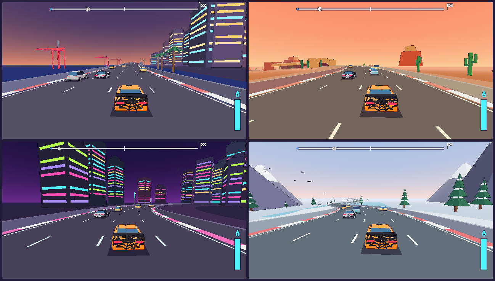
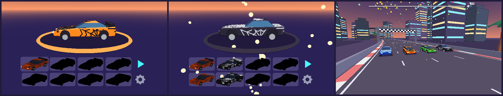
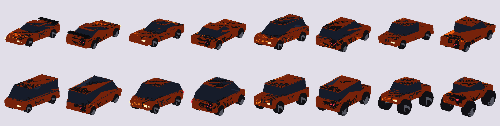
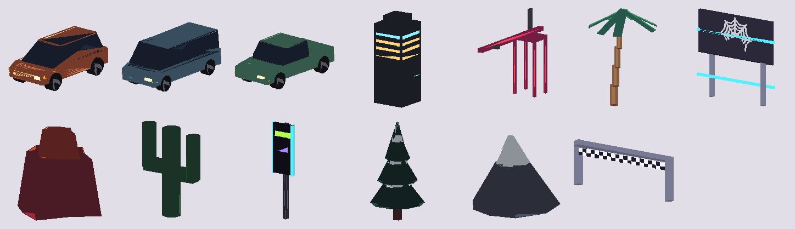

# curious-for-speed

**A street-racing game for a young kid: race three rivals through two cities, a desert canyon and a snowy mountain pass, in cars covered in spider webs. Up to 4 players in split screen. No crashes, no losing, no reading. Every finished race wins a new car.**



The twin of [rail-shooter](https://github.com/MarAvFe/rail-shooter), a step less "kiddo". It's faster and darker, with rivals, traffic, nitro and driving minor-key synth music. Like rail-shooter it's wordless and has no fail state.

Every car, building, mountain, icon, sound and music loop is generated by Python scripts. The geometry is **build123d** (OpenCascade CAD) and the audio is synthesised with NumPy. The repo contains no hand-made or third-party art or audio. See [PROMPT.md](PROMPT.md) for how an AI agent built it.



## What came from the first playtest
| Seen while he played rail-shooter | Became |
|---|---|
| Leans his whole body when steering | Curves push the car outward (gently), so he steers *into* turns and leans |
| Avoids enemies instead of shooting | **Traffic to dodge**. Passing a car close without touching it refills nitro with a *swish* |
| Laughs spamming the horn | The horn **does something**: traffic ahead moves over a lane with hazards flashing |
| Shoots with intention (hold, not toggle) | **Nitro** is a hold button with a tank that drains and refills |
| "No prob dad, I'll resolve that problem" (moving door) | **Railway crossings** (the arms take turns) and **sliding barriers**. There's always an open side |
| Noticed the birds | Birds, neon-lit towers, harbour cranes, crowds in the grandstands, a tunnel, a frozen lake |
| Excited to finish a level | Fanfare, fireworks, camera swing, then a **flat podium**: all four cars side by side, no places |
| Got the hang of it after 3 levels | Starts at the back of the grid; leading rivals ease off so overtakes stick |

## Made for a young kid
- **No fail state.** Walls make you scrape, cars bump, closed gates stop you until they open. Nothing ends the race. If he lets go of everything, the car keeps driving.
- **No places.** The top bar shows every racer's progress. The finish is a flat podium with everyone level.
- **Always a reward.** Every finished race unlocks the next car, even when he repeats the same track, until all 8 are open.
- **Play together.** Up to 4 players in split screen (2 stacked, 3–4 in quarters). Rivals fill the empty grid slots and ease off for whoever is furthest back.
- **No text.** Icons only. The grown-up menu is hidden behind a 3-second hold.
- **Comfort:** the horizon never rolls, there's no screen shake, and the only FOV change is a gentle widening on nitro.
- **Invisible help.** If he keeps bumping into things, the curve push softens and leading rivals ease off. It never gets harder.
- **Button-mash proof.** Any unbound button honks.

## Play
**Windows:** download `curious-for-speed.exe` from [Releases](../../releases) and double-click it. There's no install.
**Linux:** download `curious-for-speed.x86_64`, run `chmod +x` on it, then run it.

| | Player 1 | Player 2 | Player 3 | Player 4 |
|---|---|---|---|---|
| Steer (sides) | A D | ← → | J L | V N |
| Horn (up) | W | ↑ | I | G |
| Nitro, hold (down) | S | ↓ | K | B |

Each player has exactly 4 keys, so pads can be mapped onto them with an external tool (e.g. AntiMicroX on Linux, JoyToKey on Windows). Shared keys: **Enter** = next step for everyone, **Esc** = back / pause, **hold R** = restart race, **hold F1 for 3 s** = grown-up menu. Solo, player 1 also keeps the old extras: arrows steer, Space/Shift nitro, H horn, and any gamepad works directly (stick/d-pad, A nitro, Start pause, hold Start + Select for the grown-up menu).

**Garage:** first pick how many players (1–4 people icons; ⚙ next to them, hold Enter on it for the grown-up menu). Then every player's 4 keys are shown above their turntable, and each moves their own cursor (in their own colour) over the 8 vehicles. Locked ones are black silhouettes; with 3–4 players every vehicle is open for that session, and choosing 2 players opens at least 2 for good (wins then unlock the rest as usual). **Enter** takes everyone's vehicle, then each picks a colour with their sides (6 to choose from), **Enter** again, then choose a track. Esc steps back. Holding nitro through the green light gives a rocket start. Unusual controllers (such as a PS2-to-USB adapter) can be set up for player 1 in the grown-up menu → *Set up a controller…*

## Tracks
| # | Track | Idea |
|---|---|---|
| 1 | Night Harbor | dusk city loop, lit towers, a bridge along the harbour with cranes, a railway crossing |
| 2 | Red Canyon | desert sunset highway, rolling hills, a tunnel through a butte, two sliding barriers |
| 3 | Neon Downtown | night city figure-8: the road climbs onto an overpass and crosses over itself; neon everywhere |
| 4 | Frost Pass | snowy mountain road at dawn, big climbs, pines, a bridge across a frozen lake |

Two laps, about 2.5–3 minutes per race. Traffic only drives your way, never oncoming.

## Cars
Eight vehicles, all playable, unlocked in grid order: **low wedge, muscle car, hatchback, pick-up, van, bubble car, jeep, monster truck**. The grid shows each vehicle in its own fixed colour, and any vehicle can wear any of six web liveries: **orange, black, red, green, blue, purple**. Rivals take colours nobody picked.



The web is wrapped onto the paint as real geometry: hood, roof, doors, trunk and rear panel. The chase camera shows the back of his car all race, so the rear gets webs too.




## How it's made
```
tools/*.py ──► assets/cars/*.glb, assets/tracks/*.glb, tracks/*.json, assets/audio/*.wav, assets/ui/*.png ──► Godot 4 ──► .exe
```
- **Cars (build123d):** the body is a side profile ∩ top outline (visual hull), filleted. It has a tapered greenhouse with a painted roof, and wheels sit in boolean-cut arches.
- **Web liveries:** a 2D web (spokes plus sagging threads) is extruded through the car and intersected with a thin skin just outside the paint, so every strand hugs the bodywork. Each vehicle is baked once in orange. The game swaps the exact paint and web colours for the chosen livery when it loads the car, and the build checks those colours appear nowhere else on the car.
- **Tracks are data:** a closed Catmull-Rom spline is resampled every 2 m into the road ribbon, lane dashes, curbs, walls and embankment. Overpasses and bridges get a deck underside and pillars, and a pillar never lands on another stretch of road. Props are placed only where they clear every stretch of road, and everything is merged into 400 m chunks.
- **Racing model:** each car is *(distance along the track, lateral offset, speed)*. Collisions, near misses, drafting and gates are all analytic in track space, so physics can never trap a car. Cars on the overpass and under it never interact.
- **Audio:** an engine loop with a fake gearbox, a two-tone horn, whooshes, a crossing bell, a fanfare, and minor-key driving loops per track.
- **Checks:** triangle budgets, minimum curve radius, loop closure, audio peak and seam. A self-test covers input, save and unlock rules. Good and bad bots race every track using input actions only.

## Build from source
Requirements: [Godot 4.7.2](https://godotengine.org/download) (as `godot` on PATH), Python 3.10+.
```bash
pip install build123d trimesh numpy scipy pillow
python3 tools/build_all.py            # everything (~3 min; the web booleans are the slow part)
python3 tools/build_all.py --no-cars  # tracks, audio, icons only (~1 min)
tools/run_tests.sh                    # build, import, compile check, self-test, bots on every track
godot --path .                        # play from source
godot --headless --export-release "Windows" build/windows/curious-for-speed.exe   # needs export templates
python3 tools/media.py                # README images (after the --shots / --snap / --podium tours)
```
Flags (after `--`): `--level=N` starts a track directly, `--car=N` picks a vehicle (0–7), `--players=N` races N split-screen players (with `--bot` the bot drives them all), `--bot=good|bad` turns on autopilot, `--laps=N`, `--shots` takes a screenshot tour, `--podium` shoots the flat podium, `--snap=NAME` saves a title screenshot, `--check` compile-checks the scripts, `--test` runs the input/save/unlock/pause/garage self-test.

Screenshots need a display. With `xvfb` installed, `run_tests.sh` takes them on an invisible one.

### Add a track
In `tools/tracks.py`, add a `track_N()` that returns spline control points, heights, scenery, and `gates`/`slides`/`birds`/`traffic` (use `flat_spot()` to place gates). Add it to `DEFS`, give it a palette in `tools/palette.py` and music in `tools/audiokit.py`, then bump `LEVEL_COUNT` in `scripts/systems/save.gd`.

## Licence
MIT (code and generated assets). See `LICENSES.md`.
